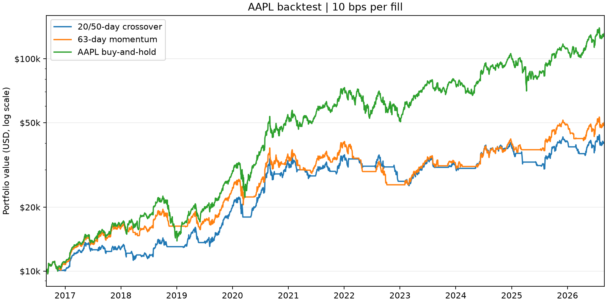

# Systematic Equity Trading Strategies & Quantitative Backtesting

A Python backtest of two long-or-cash rules on Apple (AAPL), using $10,000 of starting capital and daily Yahoo Finance prices from September 2016 through August 2026. The project compares both rules with AAPL buy-and-hold and measures the effect of transaction costs.

## Results

Full sample from September 1, 2016 to August 31, 2026, covering 2,512 trading sessions. Each row includes a cost of 10 basis points per executed buy or sell.

| Strategy | Final value | Annualised return | Sharpe | Max. drawdown | Executed orders |
| --- | ---: | ---: | ---: | ---: | ---: |
| 20/50-day moving-average crossover | $40,064 | 14.89% | 0.77 | −28.54% | 58 |
| 63-day momentum | $49,594 | 17.37% | 0.84 | −37.50% | 105 |
| AAPL buy-and-hold | $130,407 | 29.29% | 1.03 | −38.52% | 1 |

Both rules gave up return relative to buy-and-hold. The crossover had the smallest full-period drawdown, 9.97 percentage points shallower than buy-and-hold. Raising costs from zero to 25 basis points per side cut the crossover CAGR from 15.56% to 13.90% and the more active momentum CAGR from 18.61% to 15.54%.

A separate run starting September 1, 2023 resets capital to $10,000, keeps the same parameters and uses earlier prices for the initial signals. The momentum rule returned 14.15% annualised with a −20.01% drawdown. Buy-and-hold returned 19.20% with a −33.36% drawdown. This later slice overlaps the full sample.



The [results table](reports/summary.csv) contains the 0, 10 and 25 basis point full-sample runs and the three-year comparison at 10 basis points.

## Trading rules and assumptions

| Rule | Target position at the close |
| --- | --- |
| 20/50-day moving-average crossover | Own AAPL when the 20-session simple moving average exceeds the 50-session average. Otherwise hold cash. |
| 63-day momentum | Own AAPL when its adjusted close exceeds its adjusted close 63 sessions earlier. Otherwise hold cash. |
| AAPL buy-and-hold | Enter at the first evaluation session's open and hold through the final close. |

- **Timing.** Each rule uses data through the current close and fills at the next session's open. A signal from the warm-up period can trigger a fill on the first evaluation day. Portfolios are marked at each close. Any final holdings are valued at the last close.
- **Corporate actions.** The source adjusted close accounts for dividends and splits. Each day's open, high and low use the same adjusted-close-to-close factor. Fractional adjusted units make the simulation a total-return approximation.
- **Costs and cash.** The base case charges 0.10% of notional per executed side. Cash earns 0%. The model abstracts from taxes, market impact and any execution frictions beyond the stated cost.
- **Metrics.** Annualised return is the compound growth rate over the elapsed calendar time. Sharpe uses the mean and sample standard deviation of daily net returns, annualised using 252 sessions and a 0% cash rate. Drawdown is the largest peak-to-trough decline in closing portfolio value, including starting cash as the initial peak.
- **Scope.** The results describe one stock chosen in hindsight. The parameters were fixed for the runs shown. The study offers no evidence of performance across other stocks.

## Run locally

Use Python 3.9 or newer. From the project folder on macOS or Linux:

```bash
python3 -m venv .venv
source .venv/bin/activate
python -m pip install -r requirements.txt
python main.py
python -m pytest -q
```

From a fresh GitHub clone, run `python -m utils.download_data` before `python main.py`. The ZIP already contains the research CSV. See [data notes](data/README.md) for provenance and the snapshot checksum.

`python main.py --cost-bps 15 --output results/custom` changes the selected cost and output directory. A run writes `summary.csv`, `equity_curves.csv`, `trades.csv` and `equity_comparison.png`. Daily curves and trades use the selected cost, while the summary includes zero-cost and 25-basis-point comparisons.

## Project structure

| Path | Purpose |
| --- | --- |
| `strategies/` | Original strategy interface, moving-average crossover and momentum rule |
| `backtester/` | Next-open execution, position sizing, transaction costs and performance metrics |
| `utils/` | CSV loading, data validation and AAPL snapshot downloader |
| `data/` | Data provenance and the original loader fixture |
| `tests/` | Tests for data loading, signal timing, portfolio accounting, costs and metrics |
| `reports/` | Verified comparison chart and results table |
